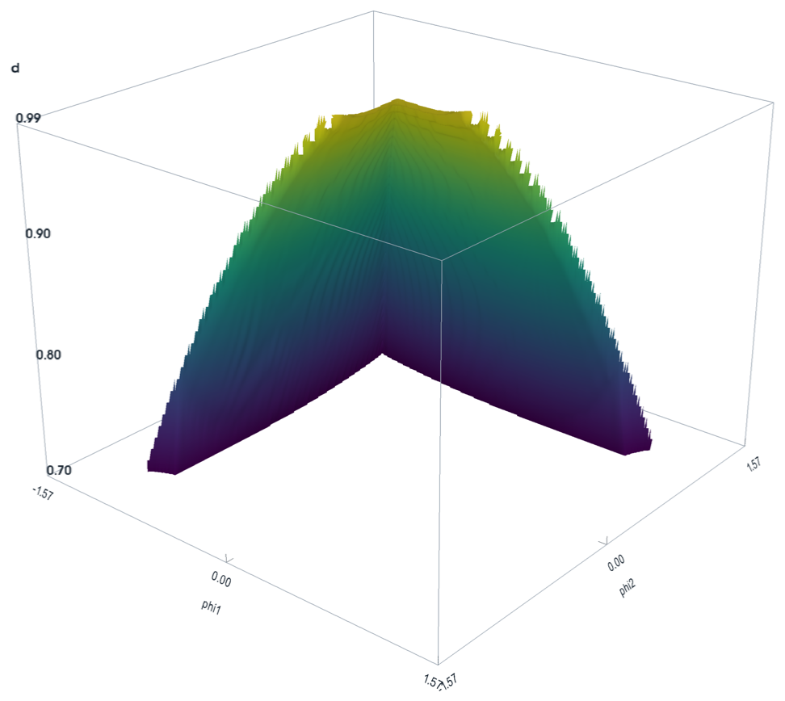

# Clamped elastica: mapping the snap surface

Numerical continuation of the planar, inextensible, clamped–clamped elastica over the
three-parameter space **(d, φ₁, φ₂)**: end-to-end distance and the two clamp angles. Every
grid point is one FEniCSx/PETSc Newton solve. The solver grows the solution from a single
exact cold start by warm starts. Each solution is classified as **bent up** or **bent down**
by its projection on the first buckling mode, and the **snap surface** is where that sign
flips with a jump.



## Repository layout

```
.
├── solver/                    the continuation solver, its config and the result checks
├── postprocessing/            postprocess.py (ParaView VTU, surfaces, figures); web/ (solution explorer)
├── presentation/
│   ├── elastica_snap_surface.pptx
│   ├── figures/               the deck's plots, written by scripts/make_figures.py
│   └── scripts/               make_figures.py; make_bistable.py (bistable region, animation)
├── notebooks/                 single_point_solve.ipynb: one solve, step by step
├── data/production/           the production run (not in git, see data/README.md)
└── environment.yml            conda environment (FEniCSx 0.11, PETSc, PyVista, ParaView)
```

## Quick start

```bash
conda env create -f environment.yml          # creates "elastica-env"
conda activate elastica-env

mkdir -p data/my_run && cp solver/config.json data/my_run/
python solver/main.py data/my_run/config.json                     # solve; Ctrl-C saves, rerun resumes
python solver/validate_results.py data/my_run/solution_space_results.npz
python postprocessing/postprocess.py data/my_run/solution_space_results.npz   # writes data/my_run/post/
python presentation/scripts/make_figures.py data/my_run                       # deck figures
python presentation/scripts/make_bistable.py data/my_run                      # bistable-region figures, animation
```

All outputs go next to the config file. For a test that runs in about 20 s, shrink the box in
the copied config, for example d 0.88–0.92, φ ±0.8, steps 0.02 / 0.04 / 0.04. On a grid that
coarse the `branches` check in `validate_results.py` can fail: its bound on same-sign jumps is
set for Δφ = 0.01.

## Governing equations

Minimise the bending energy subject to the end position and clamp angles (L = 1, EI = 1):

$$
\Pi[\theta]=\tfrac12\int_0^L \theta'(s)^2\,ds,\qquad
\int_0^L\cos\theta\,ds=d,\quad \int_0^L\sin\theta\,ds=0,\quad
\theta(0)=\varphi_1,\quad \theta(L)=\varphi_2 .
$$

With Lagrange multipliers $f_x, f_y$ (the end reaction forces), stationarity gives
$\theta'' + f_x\sin\theta - f_y\cos\theta = 0$. The solver assembles the mixed weak form

$$
\int_0^L\!\left(\theta' v' - f_x\sin\theta\,v + f_y\cos\theta\,v\right)ds = 0,\qquad
\int_0^L(\cos\theta-d)\,q_x\,ds=0,\qquad \int_0^L\sin\theta\,q_y\,ds=0,
$$

with θ in P1 Lagrange and $f_x, f_y$ in a one-DOF "Real" space. The beam has 200 elements graded
towards both clamps (0.001 L there, 0.007 L mid-span): under high tension the rod turns within
boundary layers of width $1/\sqrt{|f_x|}$. Each point is a Newton solve (SNES, cubic
backtracking, MUMPS LU) on 203 unknowns. Outputs per point: θ(s), $f_x$, $f_y$, the clamp
moments $M_1=\theta'(0)$ and $M_2=\theta'(L)$ (end slope plus a half-element Taylor correction,
second-order accurate) and the energy $U$.

## Branch tracking

**Bent up or bent down.** The transverse shape y(s) = ∫₀ˢ sin θ is projected onto the first
clamped buckling mode w₁(s) = 1 − cos(2πs/L) (`solver/branch.py`):

$$
p=\frac{\int_0^L y\,w_1\,ds}{\lVert w_1\rVert},\qquad p>0:\ \text{bent up},\quad p<0:\ \text{bent down}.
$$

The second mode is antisymmetric and carries no up/down information. p is unchanged by the
mirror (φ₁, φ₂) → (−φ₂, −φ₁) and flips under (φ₁, φ₂) → (−φ₁, −φ₂).

**Jumps.** p shrinks like √(1 − d) as the rod straightens, so jumps are judged on q = p / a(d),
where a(d) is |p| of the exact first mode at (d, 0, 0). Between neighbours q jumps when
|Δq| > `jump_tol` (0.17, which is |Δp| ≈ 0.02 at d = 0.9) and |Δq| > ½ max |q|. A sign change is
one of two things:
- **Snap:** a sign change with a jump.
- **Smooth crossing:** a sign change without a jump, where the rod passes through an S-shape
  near φ₁ = φ₂.

Past a fold, Newton can also jump without a sign change, onto the unstable S-shaped family
(p ≈ 0, high energy). The solver rejects that jump too.

**Stability.** A jump does not catch every unstable result. On the anti-diagonal φ₁ = −φ₂ the
rod is symmetric (f_y = 0), and the bent-up branch loses stability at a symmetry-breaking
bifurcation rather than a fold, so Newton follows it with no jump in q. Every candidate is
therefore also tested (`solver/stability.py`): the constrained second variation
∫ v′² − (f_x cos θ + f_y sin θ) v², with v(0) = v(L) = 0 and ∫ v cos θ = ∫ v sin θ = 0, must have
no negative direction. The count comes from the inertia of the bordered tridiagonal matrix
(Haynsworth): O(N), about 0.2 ms per node.

## The solver (`solver/`)

- **Mesh.** A uniform grid over (d, φ₁, φ₂), each cell split into 6 tetrahedra. Only the half
  φ₁ + φ₂ ≥ 0 is solved; the mirror θ̃(s) = −θ(L − s) fills the other half, with the same f_x
  and p, the opposite f_y, and the clamp moments swapped.
- **One cold start.** The exact first clamped mode at φ₁ = φ₂ = 0 and the smallest d:
  θ = 2 asin(k sn(4Ks/L | m)), m = k², with d/L = 2E(m)/K(m) − 1. Ties go to the bent-up hump.
- **The front.** Nodes are solved outward in order of grid distance. Each node is warm-started
  from its solved grid neighbours, bent-up ones first and nearest first within each branch, with
  at most 50 Newton iterations per attempt. A result is rejected if q jumps or if it is unstable.
- **Going around a fold.** A node that cannot be reached without a jump is deferred, and retried
  when a new neighbour is solved. After `max_failures_per_branch` failures from one branch it
  waits for the other branch. A region cut off by a fold is therefore never entered by jumping
  across the snap surface: the front reaches it the long way round, through the smooth
  crossings, and solves it from the far side.
- **Last resort.** Only when the front stops altogether is the nearest deferred node
  cold-started: the exact mode at (d, 0, 0), continued in the clamp angles for both hump signs,
  keeping the lower energy.
- **Promotion.** Where both branches are stable, a node reached before any bent-up neighbour
  was solved still takes the bent-down state, and which nodes those are depends on the visit
  order. After the front, every bent-down node beside a bent-up one is retried: first the
  reflection θ → −θ of the state at (−φ₁, −φ₂), when that is bent down and differs from the
  stored state by a jump in q (so not the one p ≈ 0 S-shape on φ₁ = φ₂), with no solve; then a
  warm start from each bent-up neighbour, with the front's tests. A promoted node passes the
  pass on to its neighbours, until nothing changes. Every node then holds the bent-up state
  wherever it is stable, and the snap surface is the fold of the bent-up branch. On a resumed
  run that is already complete, only this pass runs.
- **Output.** Live NPZ checkpoints (also on Ctrl-C; written to a temporary file and renamed)
  and resume. The results NPZ and VTU hold f_x, f_y, `moment` (left clamp), `moment_right`,
  `energy`, `p`, `q`, `branch` = sign(p), `solve_order`, `waited` and `promoted`; with `save_theta`, the NPZ
  also holds θ (float32).

Files:

| File | Purpose |
|---|---|
| `main.py` | the continuation front; `python main.py [config.json]` |
| `solver.py` | FEniCSx Newton solver, exact first mode, cold start |
| `branch.py` | first-mode projection p, amplitude a(d), jump rule |
| `stability.py` | O(N) stability test of an equilibrium |
| `mesh_generator.py` | the (d, φ₁, φ₂) grid and its mirror map |
| `vtu.py`, `repair_vtu.py` | VTU writer; compact VTU of the solved points of a checkpoint |
| `validate_results.py` | checks a checkpoint or result against independent references |
| `refine.py` | training data for a neural surrogate: both branches, low-energy refinement |
| `refine_iso.py` | refine.py's second sampling scheme: points on iso-energy surfaces |

`validate_results.py` checks:
- coverage, and that mirror pairs agree;
- φ₁ = φ₂ = 0 against the exact first mode (f_x = 16K², the energy and |p|);
- a random sample re-solved by scipy's collocation BVP solver (`solve_bvp`): f_x, f_y, both
  moments and the energy must agree, on the same branch;
- the branch structure: snaps, smooth crossings, rare same-sign jumps, no node on the unstable
  S-shaped family;
- stability of every node on a snap edge and of a random sample of the rest.

Key `config.json` fields:
- `d_bounds`, `phi1_bounds`, `phi2_bounds` and `grid_steps`: the box and its spacing. φ₁ and
  φ₂ must be symmetric, for the mirror.
- `beam_elements`, `beam_grading` (0 uniform, 0.8 production) and the SNES tolerances.
- `warm_start_max_it`, `jump_tol` (0.17) and `max_failures_per_branch` (3).
- `save_theta`, checkpoint intervals and the output file names.

The default box is the production one: d 0.70–0.99 and φ ±π/2, step 0.01, so
30 × 315 × 315 = 2.98 M nodes and 1.49 M solves.

## Post-processing

`postprocessing/postprocess.py results.npz` writes `post/` next to the results (about a minute):
- `elastica_solution_space.vtu`: every node and tetrahedron with p, q, branch, energy, f_x,
  f_y, |f|, both moments, the snap indicator, solve order and `waited`; open it in ParaView and
  scale z by about 10;
- `snap_surface.{vtp,stl}`, `snap_surface_jump.stl`: the p = 0 surface and its snap part;
- `iso_energy.vtp`, `iso_fx.vtp`, `iso_fy.vtp`, `iso_moment_{left,right}.vtp`: level sets over
  the jump-free tetrahedra, so they end at the snap surface;
- `energy_histogram.png`: nodes per energy bin, and the spread of U in each d layer;
- the PNGs used in the deck, and `summary.json` (field ranges, areas).

## Solution explorer (web)

```bash
python postprocessing/web/server.py            # data/production by default; another run: give its folder
                                               # --dataset other/nn_dataset.npz for other density maps
```

Open http://localhost:8765. From Windows this works too, because WSL forwards localhost, as long as
no Windows program already uses the port. If the page says "not found", start the server with
another port, for example `--port 8790`.
- **Map:** one d layer coloured by q (branch), energy, f_x, f_y, M₁ or M₂, with the snap edges
  marked. Hover to read values.
- **Data density:** points of the training dataset (`data/production_nn/nn_dataset.npz`, from
  `refine.py`) per 0.01-cube around each node: all states, either branch, the grid alone (before
  refinement) or the negatives. One log colour scale for all layers; grey boxes hold none. Each
  point counts at its nearest node; boxes cut by the edge of the domain are scaled to a whole one.
  The first start counts them (a few seconds) into `nn_dataset.density.npz`. Without the dataset
  the button is hidden.
- **Probe:** click a point to see the rod shape, θ(s), curvature θ′(s), the forces, energy and
  moments, and profiles of the field along φ₁, φ₂ and d through that point.
- **Compare:** Shift+click (or P) pins up to three points for comparison.
- **Keys:** arrow keys move the probe one grid step; PgUp/PgDn change d.
- **Export and share:** "Download θ(s) CSV" exports the rod. The URL keeps the view, so a link
  reopens the same point.
- **Iso-surfaces in 3D:** level sets of U, f_x, f_y, M₁ or M₂ over (φ₁, φ₂, d), computed by the
  server on demand (marching tetrahedra over the jump-free cells, as in `postprocess.py`, so
  they stop at the snap surface, drawn in red). Drag the level slider or type a level. "Keep"
  holds a surface so you can overlay several levels or fields. Colour the surfaces by d, by
  surface, or by another field; cut away d above or below the current layer, or half the box
  along the mirror plane φ₁ + φ₂ = 0. Hover a surface to read it; click to probe the nearest
  node, and the map, rod and profiles follow. The viewer loads three.js from cdn.jsdelivr.net,
  so the browser needs internet access.

θ is read from `solution_space_live.npz` without loading it. If that file is missing, the
first start writes a 2.4 GB `.theta.npy` cache next to the results.

### Run console

At the bottom of the explorer (or the "Run console" link at the top). It edits every parameter of
the programs and runs them:
- **Solve:** `main.py`. The box, grid steps, beam, Newton tolerances, continuation settings and
  output names, then optionally `validate_results.py` and `postprocess.py`. φ ranges accept π
  notation (`−π/2`, `pi/4`). The form estimates the node count and run time.
- **Refine:** `refine.py` on a finished solve. The scheme (points per cell, or iso-energy surfaces
  with their target exponent, scale, level step, spacing floor and projections), the
  points-per-cell rule, workers, split, the stages to run, or "plan only" (branches, then
  `sample --dry-run`).
- **Validate** and **Post-process** a finished solve.

Every run gets a new folder, `data/runs/<date>_<time>_<program>[_<name>]`. The folder is created
fresh (a `-2`, `-3` … suffix if the name is taken), so no run writes into another's folder. It
holds `config.json`, `job.json` (the parameters and the exact commands), `run.log` and
`status.json`, next to the program's own outputs.

- **Detached:** runs are started by `postprocessing/web/run_job.py` in their own session, so they
  outlive the server; the page lists them again when it is reopened.
- **Stop and resume:** Stop interrupts the step (the solver saves a checkpoint); pressing it again
  kills it. Resume continues a stopped, failed or lost run in its own folder from the step that
  did not finish; the solver and refine pick up their checkpoints.
- **Validation doesn't block:** if a validation check fails, the run still finishes, with a
  warning, and post-processing still runs.
- **Load** copies a run's parameters back into the form, to rerun with changes.
- **Explore a run:** for a finished solve the log panel shows the command, e.g.
  `python postprocessing/web/server.py data/runs/<id> --port 8766`.
- **Security:** runs can only be started when the server listens on localhost (the default). The
  POSTs need a custom header and a localhost `Host`, so other web pages cannot start them.
  `--allow-remote-runs` lifts the localhost rule when serving with `--host 0.0.0.0`.

## Production run (`data/production`, 2026-10-12)

- **Run:** every node solved (2,976,750) in about 4 h on one core (about 11 ms per solve).
  One extra cold start, at (0.99, 0.20, 0.20). 465 jumps and 17 unstable results rejected;
  1,155 nodes waited, all at d ≥ 0.97.
- **Promotion (2026-10-19, `promotion.log`):** the pass was run on the finished run by resuming
  it (`main.py` on the same config). 370 nodes by reflection and 416 by warm start
  (58,363 warm starts; 18 min with loading and saving), 1,571 with their mirror images. 1,381 of
  them are at d ≤ 0.76: thin slivers of the bistable region beside the cusps, where the front had
  passed the bent-down state along a grid row from a node above the fold's lowest point. Of the
  rest, 184 are on φ₁ = φ₂ and 6 at d ≥ 0.90. The run before
  the pass is in `pre_promotion/`. `validation_promoted.log`: all checks pass; the full stability
  re-test (`stability_full.log`) was repeated on the promoted map: none unstable.
- **Validation (`validation_final.log`):** all checks pass. BVP on 300 samples: maximum
  relative error 0.27 %, median 0.014 %. Exact first mode: f_x within 1.3e-4. Mirror pairs
  within 3e-8. A stability re-test of all 2,976,750 nodes finds none unstable
  (`stability_full.log`).
- **Ranges:** f_x from −13,785 (tension, d = 0.99, |φ| = π/2) to +93; |f_y| ≤ 340; clamp
  moments within ±168; energy 0.10–142.
- **Branch share:** bent up on 70.6 % of the layer at d = 0.70, falling almost linearly to
  50.5 % at d = 0.99.
- **Snap surface:** 30,081 snap edges, area 2.64 in (φ₁, φ₂, d) units. In each d layer it is an
  L-shaped curve with its corner on the anti-diagonal φ₁ = −φ₂ and its ends on the diagonal
  φ₁ = φ₂; it closes in on the origin as d → 1. At φ₂ = 0 it sits at φ₁ ≈ −0.98 (d = 0.70),
  −0.57 (0.90) and −0.18 (0.99).

## Training data for a neural surrogate (`solver/refine.py`)

A network that maps (d, φ₁, φ₂, branch) to U, f_x, f_y, M₁, M₂, and to whether that branch exists
there, is queried most at low energy. The production grid is uniform, so only 2.4 % of its nodes
have U < 1, all at d ≥ 0.91 (U_min ≈ 10(1 − d)). `refine.py` builds a dataset that is denser at
low U and holds both stable branches wherever they coexist:

```bash
python solver/refine.py data/production_nn/config.json branches        # both branches on the grid
python solver/refine.py data/production_nn/config.json sample --dry-run  # counts, time, predicted histogram
python solver/refine.py data/production_nn/config.json sample          # parallel; Ctrl-C and rerun resumes
python solver/refine.py data/production_nn/config.json export          # nn_dataset.npz
python solver/refine.py data/production_nn/config.json check
```

- **Branches** are labelled by the sign of p. Besides the mirror, the reflection θ → −θ maps a
  solution at (φ₁, φ₂) to one at (−φ₁, −φ₂) with the opposite p. So the up branch everywhere fixes
  the down branch everywhere, and wherever the stored states at x and −x are on the same branch,
  the reflection is the second branch at x, with no solve. A front then extends the up branch into
  the nodes still without it, with the solver's tests (no jump in q, stable), until it fails: past
  the fold. Those nodes are the negative examples for the existence output.
- **Sampling.** Each 0.01 cell gets n = clip(round((3/U)²), 1, 64) points for each branch that
  one of its corners holds, U the lowest corner energy of that branch, and at least 16 in a fold
  cell (the branch at some corners only). Besides the fold edges, that includes the cells on
  φ₁ = φ₂ outside the bistable region, where p changes sign smoothly: 4,902 of the 9,106 diagonal
  cells, so about 36 k extra solves (144 k states with their images). The explorer's density maps
  show them as a dense line along the diagonal. The points are scrambled Sobol with a random shift per
  cell, so they are spread inside the cell and not on a lattice. Only the up branch in
  φ₁ + φ₂ ≥ 0 is solved; the mirror and the reflection give the other three images, so a quarter
  of the dataset's states are solves. A point in a fold cell that fails from every corner tried is
  a negative example.
- **Dataset** (`nn_dataset.npz`): one row per (point, branch) with inputs `d`, `phi1`, `phi2`,
  `branch` (±1), targets `energy`, `fx`, `fy`, `moment` (left clamp), `moment_right` (NaN on negatives) and
  `exists`; also `p`, `q`, `source`, `cell`, `fold_cell` and `split`. The train / validation / test
  split (80 / 10 / 10) is by whole cell, stratified by energy band, and takes all four images of a
  cell together, so no test point has its own image or its own cell's corners in training.
- **Checks** (`check`): reflected states re-solve in ≤ 1 Newton iteration; every snap-edge node
  holds both branches or is on a fold; two states at a node differ by a jump, unless they are the
  one p = 0 S-shape on φ₁ = φ₂; a refined state re-solved from the farthest corner is the same
  state; a BVP sample agrees; every state's images are rows, in the same split. The energy
  histogram of the dataset is written to `post/`.

### Second scheme: iso-energy surfaces (`solver/refine_iso.py`)

With `"scheme": "iso"` in the config, `sample` places the new points on level sets of the up
branch's energy over the grid instead of inside cells, and chooses how many go on each level so
that the dataset's energy histogram follows a decreasing target. `branches`, `export` and `check`
are the same; `--dry-run` plans the points and writes the predicted histogram
`post/energy_histogram_iso_planned.png`.

```bash
python solver/refine.py data/production_iso/config.json sample --dry-run   # plan: iso_plan.npz, histogram
python solver/refine.py data/production_iso/config.json sample             # solve; Ctrl-C and rerun resumes
python solver/refine.py data/production_iso/config.json export
python solver/refine.py data/production_iso/config.json check              # + post/energy_histogram_iso.png
```

`data/production_iso/config.json` reuses `../production_nn/branches_grid.npz` (`branches_npz`),
so it needs no `branches` stage.

- **Target histogram.** Rows of the dataset per unit U:
  $H(U) = C\,U^{-\alpha}$ from the lowest energy up to the peak of the grid's own histogram
  ($U_p \approx 3.5$), and the grid alone above it, where the grid already falls.
  $C = \text{scale}\cdot H_\text{grid}(U_p)\,U_p^{\alpha}$, so at scale 1 the power law meets
  the grid at its peak and the histogram decreases monotonically over the whole range.
- **Why α = 1.** U spans three decades (0.1 to 142), and the accuracy that matters is relative:
  a network fits log U, or U with a 1/U² weight. Then each decade of U needs the same amount of
  data, $H \propto 1/U$, which is ten times the rows per unit U at U ≈ 0.1 as at U ≈ 1, and
  gives an absolute error that shrinks with U. α = 2 would be what plain MSE on U needs for the
  same relative error. On the production grid that puts 89 % of the rows below U = 1 (46 % at
  α = 1) and needs 15.5 M solves, 11 times as many (α = 1.5: 4.3 M, 72 %).
- **Levels.** $U_k$ geometric, 5 % apart (`level_step`), from the lowest grid energy up to $U_p$.
  Level k gets the target's rows in its interval, less the grid rows already there, divided by
  four (each solve gives four rows, by the mirror and the reflection).
- **Surfaces.** Marching tetrahedra over the explorer's 6-tetrahedron split of every cell,
  restricted to tetrahedra whose four corners hold the up branch with no jump in q. A surface
  therefore ends at the fold. Only φ₁ + φ₂ ≥ 0 is kept.
- **Regular spacing.** The candidates are the surface's own vertices (one per crossed grid edge)
  and a barycentric lattice in every triangle at half the target spacing. A greedy Poisson-disk
  pass keeps the vertices first, then the lattice points, each only if no kept point lies within
  r. No two points are closer than r and no gap is wider than about 1.5 r (measured
  nearest-neighbour distance: median 1.06 r, 99.9 % below 1.54 r; 63 of the 1.33 M points, up to 3.2 r). r is tuned per level until the count
  is within 3 % of the target, with a floor of 0.05 grid steps (`min_spacing`).
- **Solve.** Warm start from the cell's corners holding up, nearest first, with main.py's tests.
  The solve lands near but not on $U_k$, because the surface came from linear interpolation;
  near d = 0.99 that is off by a few %. The point then moves along the energy gradient, which
  the solve already gives by the envelope theorem:
  $\nabla U = (\partial_d U, \partial_{\varphi_1} U, \partial_{\varphi_2} U) = (-f_x,\,-M_1,\,M_2)$
  (checked against finite differences on the grid: 3e-5 in φ). It is re-solved from the state
  just found, up to `project_steps` times, until $|U/U_k - 1| < 10^{-4}$. Steps that would leave
  the box slide along its face.
- **Settings** (`"iso": {...}`): `alpha` (1), `scale` (1), `u_max` (default $U_p$), `level_step`
  (0.05), `min_spacing` (0.05 grid steps), `count_tol` (0.03), `project_steps` (4), `project_tol`
  (1e-4). The plan is saved to `iso_plan.npz` and reused by the solve; changing a setting that
  shapes the plan asks for it to be deleted first.
- **Production (`data/production_iso`, 2026-10-18).** 74 levels from U = 0.10 to 3.5, planned in
  2.5 min; 1,325,287 solves in 28 min on 14 workers, none dropped, 99.78 % within 1e-4 of their
  level (the rest median 3e-4 off; a few, where U has a valley between grid nodes near d = 0.99,
  up to 7 %). Dataset: 8.9 M states (5.3 M from the surfaces), 45 % with U < 1 (cells scheme: 29 %).
  All `check` tests pass. The rows per unit U follow 1.81 M/U from U = 0.12 to 3.5. The first four
  levels, within 20 % of the lowest energy, are small caps on the d = 0.99 face and would need
  points closer than the 0.05-step floor, so they hold 2.6 k–21 k points instead of 22 k
  (`post/energy_histogram_iso.png`). On 0.25-wide bins no bin rises except two in the grid's
  sparse tail above U = 50, by at most 18 rows. Explore it with
  `python postprocessing/web/server.py --dataset data/production_iso/nn_dataset.npz`.

## Presentation

`presentation/elastica_snap_surface.pptx` (46 slides; `elastica.pdf` is its LibreOffice export):
the governing math, the snap surface and the buckling-mode criterion, the bistable region, the
continuation strategy (deferral, stability test, exact cold start, mirror symmetry), the production
results and the two refined-sampling schemes. Every data plot comes from `data/production`, or for
the refinement sections `data/production_nn` and `data/production_iso`;
`presentation/scripts/make_figures.py`, `make_bistable.py`, `make_refinement.py` and
`make_refinement_iso.py` regenerate them in `presentation/figures/`. Equations are PowerPoint equations.

The refined-sampling section (slides 35–41) is written for readers new to the method. It gives
the points-per-cell rule n(U_min) with the partial-cell minimum; how the points fill a cell (what
a cell is, why a Sobol sequence rather than random points or a lattice, and the random shift per
cell); how each point is solved (warm start from the nearest solved corners, the acceptance tests,
"no rod here" examples, and the symmetry that gives four rods per solve); then the energy
histograms before (the production run, one state per node: 2.4 % with U < 1) and after (the
dataset, 7.6 M states: 28.9 % with U < 1) on the same bins and axes; and the same before/after
in 3D, over the whole domain (the same random 1 % of points drawn from each, so dot density is
data density) and close up on 5 × 5 × 3 cells near d = 0.97 (every point).

The iso-energy section (slides 42–46) covers `refine_iso.py`: the 1/U target histogram and why, the
levels and how many points each gets; the level surfaces and their Poisson-disk points (one level
in 3D, and the nearest-neighbour spacing over all levels); the solve and the projection onto the
level along the envelope-theorem gradient; and the cell and iso datasets on the same bins.

The bistable-region section (slides 14–21) compares the solve with a bent-down cold start. That
second map is the solve under θ → −θ, the mirror image in φ₁ = φ₂ with the branches swapped, so it
needs no new solves. Where the two disagree, the rod has two stable shapes for the same clamps. The
section covers that region's definition, its fold edges and cusps, the hysteresis across it, how
it shrinks with d, and the cusp where its two fold curves meet on the diagonal. Slide 21 embeds
`figures/branch_walk.mp4`: one rod at d = 0.82 taken across the region, where it snaps and changes
branch and with it the snap curve it can meet, then round the end of the snap curve, where it
changes branch with no snap.

## Known issues

- **Near d → 1.** At d = 0.99 and φ = ±π/2 the tension reaches f_x ≈ −13,800. A uniform
  100-element beam is then off by up to 40 %; the graded 200-element beam agrees with the BVP
  check to 0.3 %. Check this again before raising `d_bounds` past 0.99.
- **Visit order and the bistable region.** Where both branches exist, the front alone gives a
  node the branch of the first neighbour whose warm start passes. Trying bent-up neighbours
  first and the promotion pass make the result the bent-up branch wherever it is stable,
  whatever the order; a run made before 2026-10-19 needs the pass (resume it).
