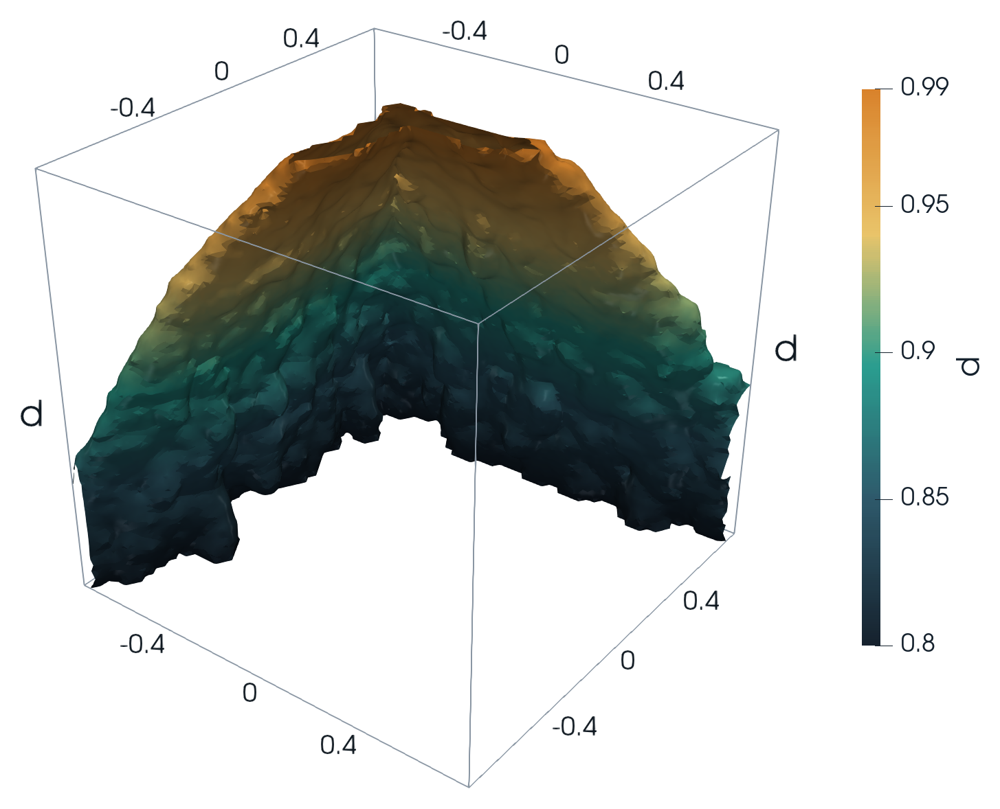

# Clamped elastica: mapping the snap surface

Numerical continuation of the planar, inextensible, clamped–clamped elastica over the
three-parameter space **(d, φ₁, φ₂)**: end-to-end distance and the two clamp angles. Every
point is one nonlinear FEniCSx/PETSc solve. The codes march through the parameter space with
warm starts, and use the **Modal Assurance Criterion (MAC)** to detect and handle the
**snap surface**, where the rod jumps from one equilibrium branch to another.



## Governing equations

Minimise the bending energy subject to the end position and clamp angles (L = 1, EI = 1):

$$
\Pi[\theta]=\tfrac12\int_0^L \theta'(s)^2\,ds,\qquad
\int_0^L\cos\theta\,ds=d,\quad \int_0^L\sin\theta\,ds=0,\quad
\theta(0)=\varphi_1,\quad \theta(L)=\varphi_2 .
$$

With Lagrange multipliers $f_x, f_y$ (the end reaction forces), stationarity gives
$\theta'' + f_x\sin\theta - f_y\cos\theta = 0$. The solvers assemble the mixed weak form

$$
\int_0^L\!\left(\theta' v' - f_x\sin\theta\,v + f_y\cos\theta\,v\right)ds = 0,\qquad
\int_0^L(\cos\theta-d)\,q_x\,ds=0,\qquad \int_0^L\sin\theta\,q_y\,ds=0,
$$

with θ in P1 Lagrange (100 elements) and $f_x, f_y$ in a one-DOF "Real" space. Each point is a
Newton solve (SNES, cubic backtracking, MUMPS LU). Outputs per point: θ(s), $f_x$, $f_y$, clamp
moment $M_0=\theta'(0)$ and energy $U$.

**Snap detection.** Two neighbouring solutions are compared with

$$
\mathrm{MAC}(\theta_a,\theta_b)=\frac{(\theta_a^T\theta_b)^2}{(\theta_a^T\theta_a)(\theta_b^T\theta_b)} .
$$

Between smooth neighbours MAC ≈ 0.9999; across the snap it drops below 0.1 (0.087 at d = 0.90, φ₂ = 0).

## Repository layout

```
.
├── solvers/                   one folder per code generation (run from inside the folder)
│   ├── v1/                    tet-mesh DFS traversal, MAC accept/reject   (was CURRENT/)
│   ├── v2/                    v1 + reusable solver object, live checkpoints (was CURRENTv2/)
│   ├── v3/                    d-layer sweep, adaptive MAC step halving, gradient refinement (was CURRENTv3/script/)
│   └── v4/                    distance-ordered traversal, MAC gate + first-mode cold restart, VTU output (was CURRENTv4/script/)
├── notebooks/                 single-point solver walkthrough (working-elastica-v2.ipynb)
├── postprocessing/
│   └── snap_surface_3d/       MAC indicator from a results VTU + ParaView rendering of the 3D snap surface
├── presentation/              slide deck, its figures, and the scripts used to edit it
├── results/figures/           summary plots from the main runs
├── data/                      simulation output; not in git (see data/README.md)
└── environment.yml            conda environment (FEniCSx 0.11, PETSc, gmsh, ParaView)
```

## Solver versions

| | Traversal and continuation | Role of MAC | On a failed or rejected step | Last edited |
|---|---|---|---|---|
| **v1** | Depth-first walk over a structured tet mesh (gmsh, 6 tets per cell); warm start from solved neighbours | Accept/reject vs. warm-start neighbour | Try the next solved neighbour | 2026-09-21 |
| **v2** | As v1, with one reusable `ElasticaSolver` and live NPZ/PNG checkpoints | As v1 | As v1 | 2026-09-21 |
| **v4** | Nodes sorted by grid distance from a cold-start node; warm start from the nearest solved grid neighbour; mirror symmetry; VTU for ParaView; checkpoint and resume (Ctrl-C saves a checkpoint) | Gate (threshold 0.85) | Cold start: continue the clamp angles from the exact first clamped mode (both hump directions, keep the lower energy) | 2026-09-25 |
| **v3** | Sweep d layer by layer; greedy nearest-neighbour walk in (φ₁, φ₂); a single cold start; mirror symmetry | Step-size control (threshold 0.90) | Halve the step, up to 5 times (32 sub-steps), then accept the jump as physical | 2026-09-26 |

By file dates **v3 is newer than v4**, despite the folder names. v3 also adds θ-gradient-driven
refinement: extra points at edge midpoints where ∂θ/∂φ is largest, which concentrates
solves on the snap surface.

## Setup

```bash
conda env create -f environment.yml      # creates "elastica-env"
conda activate elastica-env
```

## Running

Each solver reads `config.json` from its folder and writes its output there; output files are
git-ignored. Move finished runs into `data/`.

```bash
# v3 (most developed): per-d-layer adaptive continuation
cd solvers/v3
python main.py config.json
python vis.py plot solution_space_results.npz        # matplotlib slices; also: gradient, interactive
python npz_to_vtk.py solution_space_results.npz out.vtk

# v4: tet-mesh traversal with MAC gate, NPZ + VTU output
cd solvers/v4
python main.py                                       # resumes from solution_space_live.npz if present
python repair_vtu.py solution_space_live.npz         # compact VTU of the solved points only

# v1 / v2
cd solvers/v1 && python main.py
```

Key `config.json` fields: parameter bounds and steps (`d_bounds`, `phi1_bounds`,
`phi2_bounds`, `grid_steps` in v4), `beam_elements`, SNES tolerances, `mac_threshold`,
`cold_start`, and (v3) `max_mac_refinements` and `gradient_refinement`.

## 3D snap surface

```bash
python  postprocessing/snap_surface_3d/make_mac_vtu.py            # reads data/v4/sol2_0.02_snes_relaxed/*.vtu
pvpython --force-offscreen-rendering postprocessing/snap_surface_3d/render_snap.py
```

`make_mac_vtu.py` computes MAC on every tetrahedron edge of the 0.02 v4 run (675k edges).
Each node gets the largest 1 − MAC among its edges. `render_snap.py` contours that field at
1 − MAC = 0.1 (MAC = 0.90) in ParaView, smooths it, and writes the three figures to
`presentation/figures/` plus a ParaView state file to `data/snap_surface_3d/`. 88 % of the
flagged edges also show an energy jump above 0.5.

## Presentation

`presentation/elastica_snap_surface.pptx` covers the governing math, the snap surface in 2D
and 3D, both continuation strategies, open issues, and options for a production run to train
a data-driven controller. Equations are LaTeX text boxes, ready to convert with PowerPoint's
equation editor. `presentation/build_scripts/` keeps the scripts that edited the deck, as a
record only.

## Known issues

- **v3 mirrored moment sign.** `build_result_arrays` stores −θ′(L) for mirrored points; from
  θ̃(s) = −θ(L − s) the correct value is +θ′(L), as v4 stores.
- **Near d → 1.** The v4 0.02 run has 4,597 of 21,829 points with d ≥ 0.95 at f_x < −50 (min
  −1,100), likely tension boundary layers at the clamps; that run used 50 elements, so check mesh
  convergence.
- **Unused setting.** v3's `continuation_candidates` is read but unused; only the last
  accepted solution is tried as a warm start.

## Data

Run outputs (about 1.9 GB) are not in the repository. `data/README.md` lists every run with
its parameter box, size and producing solver.
